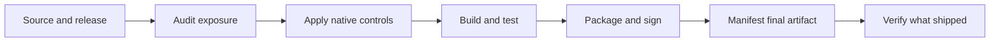

<div align="center">

# CloneGuard by Anish

### Your app ships. Your implementation doesn't have to.

Open-source release defense for an era of AI-assisted cloning.

[](https://github.com/anishpras/cloneguard/actions/workflows/ci.yml)
[](LICENSE)
[](https://www.python.org/downloads/)


[Quick start](#quick-start) · [Install the skill](#use-it-with-your-coding-agent) · [Platforms](#one-workflow-different-platforms) · [Benchmarks](#evidence-you-can-reproduce) · [BLA comparison](#cloneguard-and-bla) · [Work with me](#want-your-application-reviewed)

</div>

AI agents can inspect a product's frontend, binaries and API traffic, then help rebuild what they observe. CloneGuard helps you reduce what a release accidentally exposes, apply the controls your platform supports, and keep a verifiable record of what you shipped.

It combines an agent skill, a dependency-free local CLI, and a read-only MCP server. **v0.1 is a release-exposure and hardening workflow, not a universal anti-cloning compiler.** Public behavior remains observable. Code that runs on a customer's device remains inspectable.

```text
$ ./cloneguard audit ./dist
  JSON findings, screened files, platform hints and explicit coverage gaps

$ ./cloneguard stage ./dist --out ../public-release --dry-run
  Preview private maps, symbols and key files to exclude

$ ./cloneguard manifest ../public-release --out ../release-receipt.json
$ ./cloneguard verify ../public-release --manifest ../release-receipt.json
  Detect modified, added or missing release files
```

## What ships today

| Capability | What it actually does |
| --- | --- |
| **Local release audit** | Finds known credential patterns, source maps, embedded source content, debug companions, environment/key files and Apple debug entitlement plists. Findings redact matched credential values. |
| **Platform-aware skill** | Guides your agent through Swift/Apple, web/API, Android/JVM, Flutter, React Native, Electron, Tauri, native, .NET and Python build boundaries. |
| **Public web staging** | Copies loose web assets into a new tree, omits known private artifacts, and gates the result. Retained bytes stay unchanged; originals remain. |
| **Release receipts** | SHA-256 inventories detect changed, added and missing files. Optional HMAC authenticates receipts to shared-key holders. |
| **Scoped canaries** | Creates non-secret per-app/per-release markers and locates them in authorized local artifacts. A match is a lead, not a legal conclusion. |
| **Agent integration** | A standalone `SKILL.md` package plus root-scoped, read-only MCP tools. No inspected-code execution, external service, account or API key. |



## Quick start

Requires **Python 3.10+**. No `pip install`, npm install, cloud account or telemetry.

This is Anish's independent project. The PyPI package named `cloneguard` is unrelated; install this repository's skill or use the local commands below.

```sh
git clone https://github.com/anishpras/cloneguard.git
cd cloneguard

# Understand a mixed project without executing its code.
python3 cloneguard plan /path/to/project --scope source

# Screen what customers actually receive.
python3 cloneguard audit /path/to/release --scope release

# Save a report outside the release tree. Existing files are never overwritten.
python3 cloneguard audit /path/to/release --out /private/reports/release-audit.json
```

On macOS/Linux, `./cloneguard` is equivalent to `python3 cloneguard`. On Windows, use `py -3 cloneguard` or `python cloneguard`.

Exit codes work in CI: **0** = screening completed below the selected threshold; **1** = findings at/above threshold or a manifest mismatch; **2** = error or incomplete screening. `--fail-on none` never turns an incomplete scan into a pass.

```sh
# A loose static web release only. Preview, then create a new output tree.
python3 cloneguard stage /path/to/dist --out /path/to/new-public-release --dry-run
python3 cloneguard stage /path/to/dist --out /path/to/new-public-release

# Keep this receipt outside its release tree.
python3 cloneguard manifest /path/to/new-public-release --out /private/release.json
python3 cloneguard verify /path/to/new-public-release --manifest /private/release.json
```

Staging excludes `.map`, debug-symbol companions, environment/key files and VCS metadata. It refuses signed bundles, executable containers, native binaries, source trees, symlinks, incomplete inventories and unresolved high-severity findings. It does not rewrite JS or remove inline maps: fix those in your bundler, rebuild and recheck. Keep original maps private for crash diagnostics.

### Authenticate a receipt

```sh
python3 cloneguard keygen --out /private/cloneguard/receipt.key
python3 cloneguard manifest /path/to/final-app.ipa \
  --out /private/cloneguard/release.json --key-file /private/cloneguard/receipt.key
python3 cloneguard verify /path/to/final-app.ipa \
  --manifest /private/cloneguard/release.json --key-file /private/cloneguard/receipt.key
```

HMAC is shared-key authentication, not a public signature or trusted timestamp. Keep the key outside source control and releases. Native signatures still need native verification.

### Add a harmless marker

```sh
python3 cloneguard canary --app my-app --release build-42 \
  --key-file /private/cloneguard/receipt.key --out /private/cloneguard/marker.json

# Integrate the marker explicitly as a resource before packaging/signing.
python3 cloneguard find-canary /path/to/authorized-artifact \
  --marker /private/cloneguard/marker.json
```

Markers grant no access. Matches establish token presence, not infringement, AI use or the identity of a copier. Encoded, stripped or transformed markers may be missed.

## Use it with your coding agent

Install the complete [`skills/cloneguard`](skills/cloneguard) directory into your agent's skill directory. For Codex on macOS/Linux:

```sh
mkdir -p "${CODEX_HOME:-$HOME/.codex}/skills"
cp -R skills/cloneguard "${CODEX_HOME:-$HOME/.codex}/skills/cloneguard"
```

If that destination already exists, review/update it instead of nesting another copy. Other agents that support `SKILL.md` can load the same folder from their configured skill directory.

Then ask:

> Use $cloneguard to audit this application, apply the appropriate release controls, and show me what was validated.

The skill tells the agent to preserve signing, public interfaces, accessibility and crash diagnostics; apply platform-native controls; run actual project tests; and mark unavailable checks unassessed. It does not blindly rename Swift symbols or inject hidden instructions into your DOM.

### Optional MCP server

```sh
python3 /absolute/path/to/cloneguard mcp --root /absolute/path/to/your-project
```

Add an entry to your MCP client's configuration using its normal format:

```json
{
  "mcpServers": {
    "cloneguard": {
      "command": "python3",
      "args": ["/absolute/path/to/cloneguard", "mcp", "--root", "/absolute/path/to/your-project"]
    }
  }
}
```

Tools: `cloneguard_audit` and `cloneguard_plan`. Both stay within the configured root and are read-only. Stdio protocol: MCP `2025-06-18`. No HTTP listener, shell tool, auto-installation or edits to your agent configuration. Large detail lists are capped with explicit truncation counts.

## One workflow, different platforms

**Platform-agnostic does not mean one binary transformation works everywhere.** Generic byte screening and receipts are independent of the language. Build hardening is delegated to the correct toolchain.

| Platform | Audit/receipt support | Skill-guided controls | Not claimed by v0.1 |
| --- | --- | --- | --- |
| Swift / SwiftUI / Apple | Swift project detection, plist checks, bounded IPA members, final artifact hashes | Resolved Release settings, private dSYMs, signing order, App Attest validation | Swift obfuscator, signed Mach-O rewriting, App Store approval |
| Web / Node / API / WASM | Public asset checks, map/credential exposure, web staging, WASM identification | Bundler controls, server-side authorization, minimal responses and quotas | Invisible API schemas, JS-to-WASM compiler, anti-vision barrier |
| Android / JVM | Gradle detection, bounded APK/AAB/JAR members, final hashes | R8/keep rules, private mappings, Play Integrity flow | APK resigning, DEX semantic analysis or device validation |
| Electron / Tauri | Project detection and outer artifact hashes; ASAR contents unassessed | IPC boundaries, supported fuses, packaging/signing | ASAR patcher or debugger blockade |
| Rust / Go / C/C++ | Build hints, ELF/PE/Mach-O identification, byte screening and hashes | Release/linker settings, private symbols, FFI compatibility | Native code virtualization or decompiler immunity |
| .NET / Python / Flutter / React Native | Project hints, source/debug exposure, ZIP member screening and hashes | Publishing/obfuscation constraints, private diagnostics, server boundaries | Universal bytecode hardening or automatic attestation |

See the [platform references](skills/cloneguard/references) for concrete constraints and official documentation.

### Screening limits are part of the result

Default limits: 10,000 filesystem entries, 16 MiB per file, 256 MiB aggregate bytes, 2,000 archive entries, two ZIP levels and a 100:1 expansion ratio. `audit` accepts `--max-file-mib` and `--max-total-mib` for deliberate larger scans. Symlinks and special files are not followed. Archives are read in memory without extraction. Opaque containers such as ASAR/DMG require native tools and make the scan incomplete.

Source mode lists skipped dependency/cache directories. Release mode applies no such directory exclusions. `complete: true` only means the configured path/byte screening completed. It says nothing about runtime authorization, signature validity or resistance to reconstruction.

## Evidence you can reproduce

```sh
python3 -m unittest discover -s tests -v
python3 scripts/benchmark.py --out /tmp/cloneguard-benchmark.json
```

The [committed local result](docs/benchmarks/local-2026-10-30.json) uses a synthetic four-file web release. It removed two private files from the public tree, reduced high/critical findings from **3 to 0**, retained every remaining byte, preserved the originals and detected a subsequent modification. This tests release hygiene and integrity, not an AI agent's ability to recreate an application.

The suite exercises credential redaction, ZIP expansion/traversal limits, incomplete scans, mixed Swift/web/native detection, binary plist validity, safe staging, keyed receipts, authentication downgrade rejection, canary scoping and an actual MCP subprocess exchange. CI runs a Linux/macOS/Windows and Python 3.10/3.13 matrix. A configured matrix is not a claim that every runner already passed; the badge links to the live result.

We do **not** publish invented attacker token counts, guaranteed hallucination rates or a dollar “bankruptcy” score. Full agent reconstruction trials need fixed tasks, behavior tests, repeated trials and recorded usage. See [benchmark methodology](docs/benchmarks/README.md).

## CloneGuard and BLA

[BLA (Blind LLM Agents)](https://github.com/qybaihe/bla) is an MIT-licensed project that injects decoys and format-specific payloads to frustrate reverse-engineering analyzers. It has a substantially broader **implemented artifact-transformation engine** than CloneGuard v0.1, bundler hooks, and a real-REA probe harness. If you need opt-in experiments against specific REA limits, BLA is further along there.

CloneGuard takes a different starting point: reduce accidental release exposure, apply native controls, preserve compatibility, and make the evidence reviewable.

| Area | BLA's strength | CloneGuard's emphasis |
| --- | --- | --- |
| Artifact transformations | Many implemented format-specific decoys/exhaustion payloads | No arbitrary signed-binary rewriting; native-toolchain workflow |
| Analyzer experiments | In-tree REA probes plus estimator/showcase | Reproducible release checks; observed results separated from estimates |
| Swift / Apple | Plist/native artifact payloads | Swift build/ABI/signing guidance; no inference that plist changes protect a Swift app |
| Operational boundaries | Audit → protect → verify engine | Bounded local screening, explicit gaps, separate outputs and exact receipts |
| Licensing/evidence | MIT tooling | MIT tooling plus scoped markers and documented evidentiary limits |

We reviewed BLA at a pinned revision and ran its available local checks. [Read the source review and reproduction notes](docs/bla-review.md). This is not a blanket claim that CloneGuard defeats more analyzers or prevents more clones. The projects can complement each other, but combining transformations still needs your own compatibility tests.

## Want your application reviewed?

I'm **[Anish Prashun](https://github.com/anishpras)**. I offer application reviews focused on release exposure, cloning risk, client/server boundaries and practical hardening.

A scoped review can cover shipped artifacts, build settings, public maps/symbols, sensitive API workflows and a prioritized remediation plan with validation. No promise that a public product can become impossible to copy.

For a review, use the contact links on [my GitHub profile](https://github.com/anishpras). **Please don't upload private application code or keys to public issues.** A dedicated site with direct email and call booking will be linked when those channels are configured.

## Roadmap

- Native CI integrations with recorded signature, symbolication and release checks.
- Deployment-aware source-map/privacy verification and policy configuration.
- Repeated reconstruction trials with measured agent usage and behavior scoring.
- Framework adapters for backend entitlement and risk controls.
- Optional adversarial experiments gated by byte, runtime and compatibility budgets.

These are planned, not shipped features. An LLM hallucination compiler, DOM prompt-injection shield, encrypted-schema middleware and legal-enforcement warranty are **not** included in v0.1. [Technical/legal claim limits](skills/cloneguard/references/claims.md).

## More from Anish

Explore [my public projects](https://github.com/anishpras?tab=repositories) and follow the work behind CloneGuard. New integrations and related tools will be linked here as they become public.

## Contributing and license

Contributions with synthetic fixtures and reproducible evidence are welcome. Read [CONTRIBUTING.md](CONTRIBUTING.md) and [SECURITY.md](SECURITY.md). CloneGuard is independently implemented; BLA source is not bundled or relabeled. See [MIT License](LICENSE).
